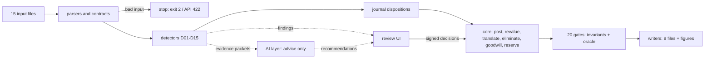

# Architecture

A consolidation of three entities into GBP for FY2024: a US parent (USD), a UK subsidiary (GBP, 100%) and an Indian
subsidiary (INR, 80%, acquired 1 July 2024). It reads the 15 supplied files and writes nine output files and 12 control
figures. An AI layer reads everything and can change nothing.

## 1. From files to figures



1. **Parsers** (`app/parsers/`) read each file into typed records. Money is `Decimal` built from text, account codes are
   text. A value that cannot exist (a negative rate, 120% ownership, a date outside the year) raises a `ContractError`
   naming the file, line and column. The command line exits 2 and the API answers 422.
2. **Detectors** (`app/detectors/`, D01 to D15) look for faults in the data: unbalanced files, a wrong mapping, a journal
   out of period, a duplicate, a reversal past zero, an unmatched intercompany invoice, text addressed to a tool, a rate
   far from its neighbours. Each known fault in the supplied data gives exactly one finding. Findings never change a
   number. A rule turns them into a disposition per journal: posted, rejected or held.
3. **Core** (`app/core/`) calculates. Postings are restated at the policy rate (closing for the balance sheet, average for
   the period owned for income and expense, historical for equity), foreign-currency items inside an entity are
   retranslated at closing (policy 3), intercompany balances and income are eliminated, goodwill is held in INR and
   retranslated, NCI is its share of net assets, and the translation reserve is worked out by two routes that must agree
   to 0.01.
4. **Gates** run after every consolidation: invariants (entries balance, the balance sheet balances, the two reserve routes
   agree) and an oracle that recomputes the figures from the raw files. Twenty checks. A failed gate is reported, never
   adjusted away.
5. **Writers** (`app/writers/`) produce the output files. The same inputs give identical bytes.

The orchestration is a LangGraph workflow (intake, analyse, resolve, consolidate, export). `resolve` is a real pause for
a person: the run stops at exit code 4 or status `awaiting_review`, and resumes from an SQLite checkpoint. A plain runner
runs the same node functions, and a test checks that both give the same output hashes.

## 2. Where code ends and the model begins

| Code decides | The model may only advise |
|---|---|
| Every number on a statement | Which unit looks risky, in words |
| Journal dispositions | Whether a mapping looks wrong |
| Findings and hard rules (D03, D04, D05) | A plain-language reason for a finding |
| Which figures are `null` | Suspicions about input lines, calculations and traces |

The boundary is built into the folders. `core`, `parsers`, `detectors`, `verification`, `writers` and `domain` import no AI
or web code. Everything under `app/agents/` is kept away from `core`. Only `app/llm/` imports a model library. `tests/test_architecture.py`
reads every source file and fails if a rule is broken.

**Three kinds of gap.** A *data gap* (the files do not give the value) is `null` with a reason: the UK SGD bank has no
GBP/SGD closing rate, so `sgd_bank_gbp` is `null` and the bank stays in total assets at its booked 23,010.00, and total
assets are marked provisional. A *method gap* (the policy is silent) is an `ASSUMED` value in
`config/assumptions.toml` with the effect of the alternative. A *defect* is a finding a person passes or overrides.

## 3. The AI layer

Two kinds of reviewer run on recorded answers by default.

- **Per-unit reviewers** (`app/agents/journal_reviewer`, `mapping_reviewer`, `review/`): one unit per mapped trial-balance line (43) and per journal (20).
  The packet holds exact joins of the data and never a detector verdict. The answer is a set of booleans and a short
  reason. A third narrow call, the injection screen, sees only each journal's quoted free text and asks whether it is aimed at a
  reviewer; its yes is proved by the D12 wording lexicon or kept as unverified. `risk` is computed in code, so a model cannot say "no risk" while flagging a category.
- **Reasoning layer** (`app/agents/reasoning/`): three read-only checkpoints. A *reader* goes through every input line in chunks.
  A *calculation reviewer* looks at each calculation record (formula, inputs with `file:line`, result). An *investigator*
  follows a concern back to its sources with six capped lookup tools. An *explain* step for rule findings is built and tested, but nothing in the CLI or the UI calls it yet.

**Grounding.** A claim is dropped when its `file:line` or calculation id does not exist, or when a quoted text or number is
not in what the model was shown. A claim that survives is *verified* only if code can prove it; otherwise it is a
*suspicion*: shown, never counted, never gating. Before a suspicion is kept, code tries to prove it false (a date claim on
a line whose dates are valid, a rate inside tolerance) and drops it as contradicted.

**Injection.** Free text in the data is quarantined and shown as a quoted string only. The JE-006 memo, which addresses
the tool, is a finding and is never obeyed. `tests/redteam/` shows that removing the memo, or a model that obeys it, changes
no disposition, figure or finding.

**The brothers example.** A tiny engine computes `age = current year - birth year` from two files that list people with
birth dates. One file holds garbage lines (`236fev2 ed = 00.02.2222`, a misspelt name, a date in 2026). The reader flags the
four bad lines, and code proves only what it can (an impossible date, a line with no readable name). When a birth year is
after the current year the age is negative: the calculation reviewer sees it, and code has already re-checked the
arithmetic. The investigator traces the age back to `fileA.txt:1` and never writes a corrected value.
`tests/unit/agents/reasoning/test_brothers.py` runs all three checkpoints on it.

**Measured result.** On gpt-4o-mini, recorded once with no prompt tuning, the layer hit 4 of 7 labelled defects, where the
rules find all 7. The reader kept 48 claims, 1 of them verified by code; the other 47 are suspicions, 38 of them on lines no
label covers. Calculation concerns fell from 26 to 4 after the contradiction and normal-side checks, none verified, and 9 of
21 trace steps survived grounding. So the rules are the detector and the layer is advice. The labels were written by the same AI tool as the rule baseline, so
this is agreement with deterministic checks and not accuracy. The seeded-fault evaluation has not been run on a live model.

## 4. When something fails

| Failure | What happens |
|---|---|
| Impossible input | The run stops before any figure: exit 2, API 422, file, line and column named |
| A step lacks an input (a missing rate) | `ConsolidationBlocked`: the run finishes, dependent figures are `null` with the reason |
| A gate fails | Reported in the manifest and on the Generate page |
| A ledger miss or an unreachable model | The rule-based answer is used; a run always finishes |
| A model timeout or refused connection | Not recorded to the ledger; five failures in a row open a circuit breaker |
| A 429 or 5xx from the provider | Two waits (2 s, 8 s); a 401, 403 or out-of-credit stops the run |
| An input changes after a run | The output is deleted and the run returns to Scan |

## 5. How a number is validated

Layers, from cheapest to most independent: the 20 gates on every run; the golden test against the hand calculation
(`tests/golden/`); perturbation tests that change a rate or add a row and check exactly which figures move
(`tests/perturbation/`); Hypothesis property tests; and the red-team tests. The golden file was written by the AI tool.
A second AI session has re-derived its figures from the raw files, and they match. No person has reviewed it yet.

## 6. How a figure traces back to source rows

Every posting carries `SourceRef` values (`file:line`). Translation, elimination and goodwill keep them. A trace walks a
figure down to the rows:

```
python run.py trace goodwill_closing
```

`app/core/calculations.py` records, for each consolidated row and each control figure, a formula, its inputs with their
source and the result. `app/verification/recalc.py` re-runs each formula and a test fails if it differs from the result.
The review UI shows this record when a reviewer clicks a row.

## 7. The review UI

A local one-user tool (FastAPI and plain JavaScript, bound to 127.0.0.1). Seven stages: Upload, Scan, Review inputs,
Choose outputs, Generate, Review outputs, Done. In Review inputs each file's rows are listed, rows with a finding are
highlighted, and clicking one shows the rule, the AI reasoning and the source line. A reviewer passes or overrides each
finding. Unanswered findings stay problems. In Review outputs each file is marked reviewed against its hash, and a click on
a row shows the calculation behind it. The export is **Final** only when no problem is open and every exported file is
reviewed, otherwise a **Draft**. The status is written to `signoff.json` in the zip.

## 8. Designed, not built

- A real override for D06 and D07 (held journals). They can be acknowledged but move no figure.
- Row marks that gate Final.
- Streamed progress while generating; the page shows each file's status when the build ends.
- Login, several users, or concurrent edits on one run.
- An AI reader for policy clauses the lexicon cannot read.
